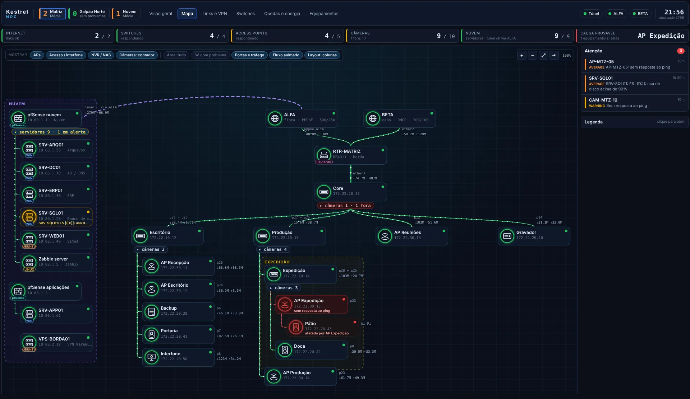

# NOC on Zabbix + Grafana, generated from one config file

Monitoring screens and Zabbix templates for a company with **one or more sites** (HQ, branches, a warehouse at
another address), each with its own edge router and internet links, plus **servers** in a cloud or datacenter
reached through VPN tunnels. You describe the network once in `noc.yaml`; `python noc.py gerar` produces the
Grafana dashboards, the Zabbix hosts and per-site templates, and a MikroTik script.

Everything here is fictional (the sample company is *Kestrel*; addresses come from documentation ranges).
The UI and the documentation are in Portuguese.

## What it solves

- **One alert instead of sixty.** The topology in `noc.yaml` drives both the map and the Zabbix trigger
  dependencies (`python noc.py dependencias --aplicar`): a switch going down raises one alert, not one per camera
  behind it; a tunnel going down raises one alert, not one per device of that site.
- **"No visibility" is not "down".** When the tunnel to a site drops, everything Zabbix still holds about that
  site is stale. The screens draw it grey with the cause, instead of red. Links with a public IP are also pinged
  directly from the cloud, so the map can still tell "the link is up, the tunnel is the problem".
- **Everything on screen agrees in time.** Availability is evaluated over recent history, with a short grace
  period after the tunnel returns, so the screen never shows an impossible mix of states.
- **Per-link internet, tested by the router itself.** Each link has a probe address routed only through it; the
  router's Netwatch toggles a sentinel IP that Zabbix pings. The per-site template alerts per link without
  flapping when the tunnel blips (separate recovery expression).
- **A site is a block of config.** A warehouse at another address is a new site (own router, links, tunnel,
  screens, host groups); a warehouse behind the same router is an *area* of a site. Both are a few lines.
- **VPN seen from the attacker's side.** A read-only collector on pfSense reports OpenVPN users, last public IP,
  certificates, failed logins on VPN/webGUI/SSH and configuration changes; attempted usernames that are real
  accounts are highlighted.

## How it works

Every screen is a Grafana *Business Text* panel whose JavaScript reads the Zabbix plugin's data frames and draws
HTML/SVG. The generator copies each screen's layout from `modelos/`, rewrites its queries for the site's hosts and
groups, and prepends a `const NOC = {...}` object with what the screen needs to know (topology, links, host types,
tabs). `tools/demo.py` renders every generated screen offline, with invented data, in headless Chromium; the
images in `docs/img/` were made that way.

Stack: Zabbix 7.4 (templates, SNMP, LLD, trigger dependencies, recovery expressions, API) · Grafana 10.4 with the
Zabbix plugin and Business Text · MikroTik RouterOS · pfSense / OpenVPN · Python · JavaScript/SVG · Playwright.

Christoffer Gavazzi · network operations and monitoring
