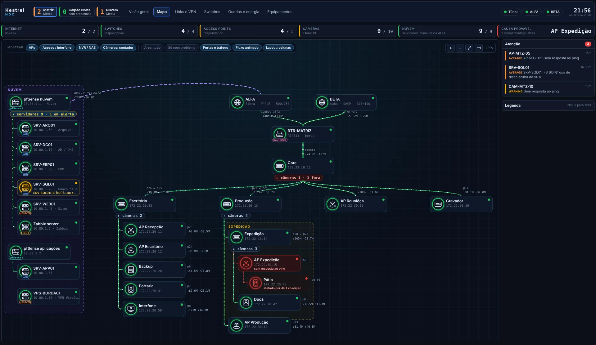
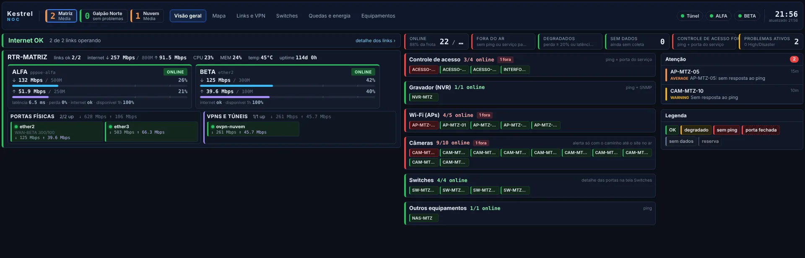
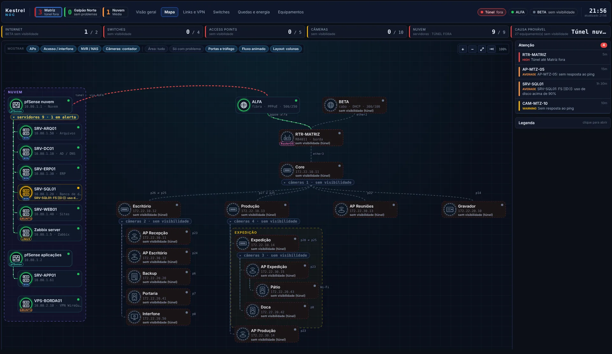
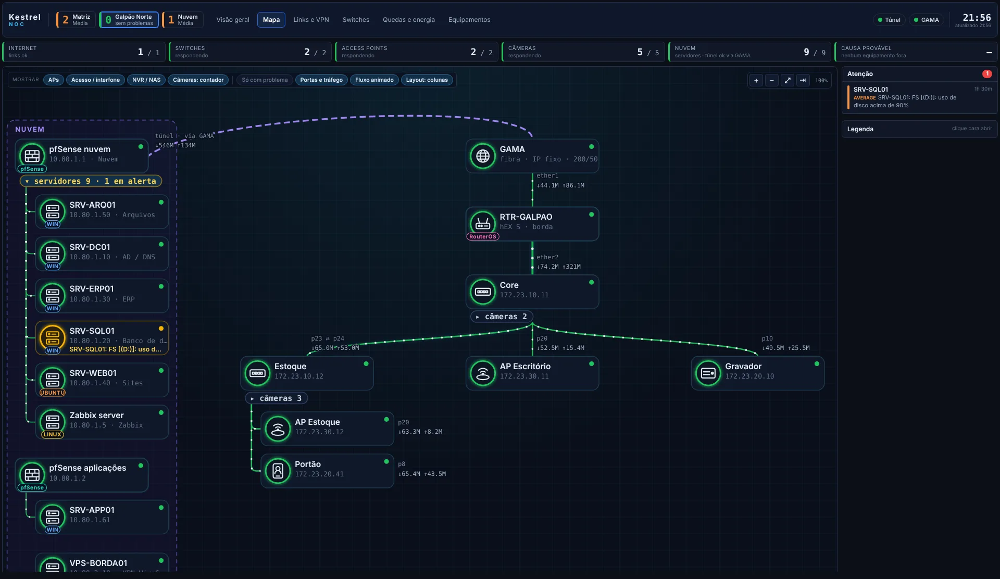
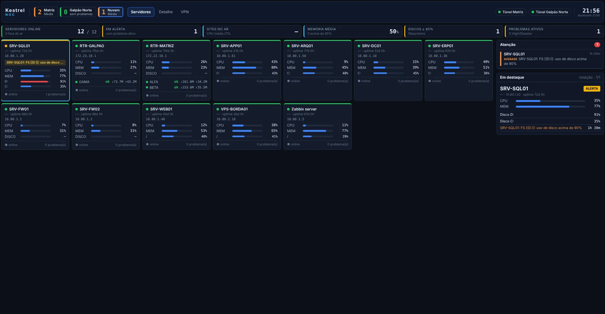
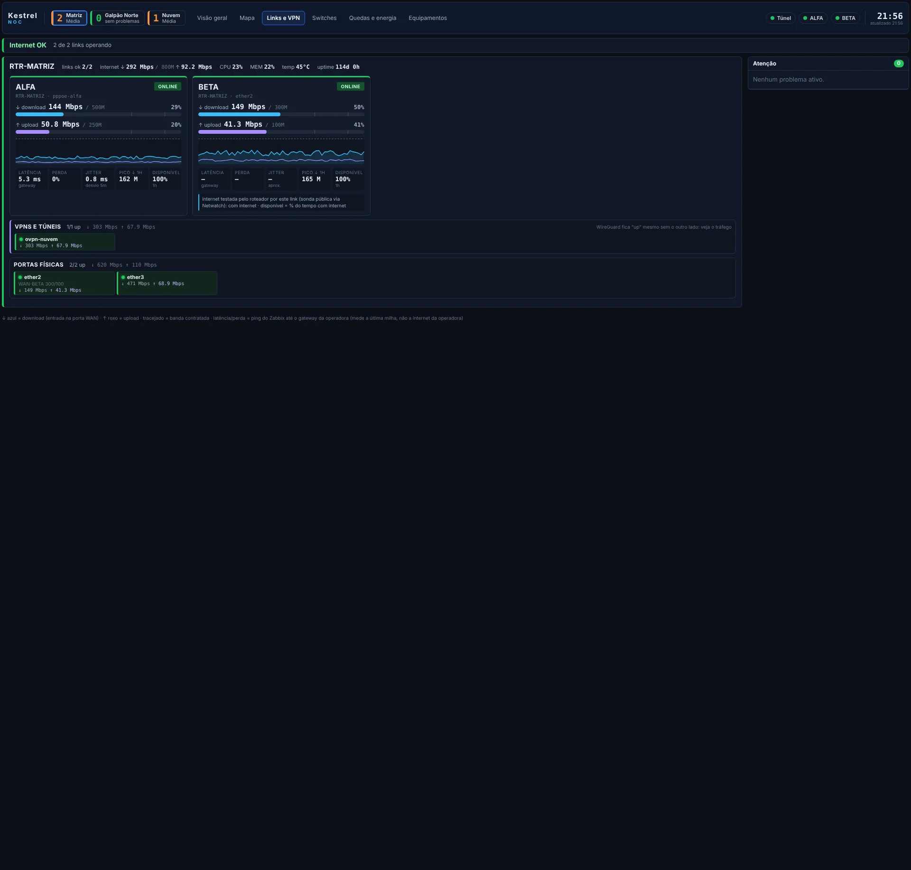
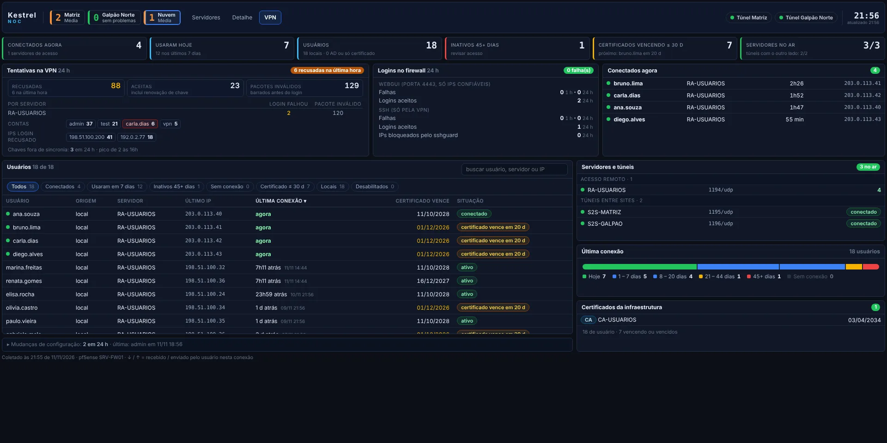
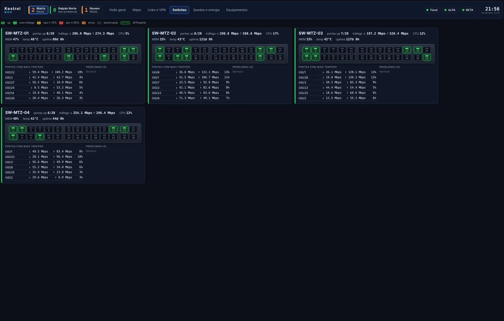
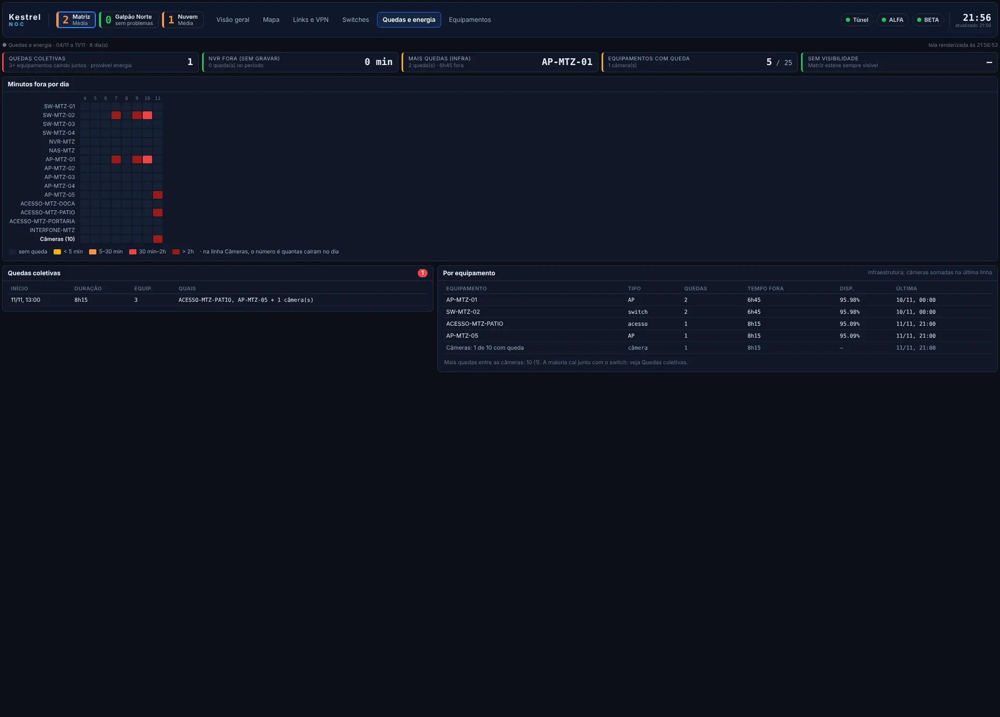

# NOC em Zabbix + Grafana

Telas de NOC para quem tem **um ou mais sites** (matriz, filial, galpão em outro endereço), cada um com roteador
e internet próprios, e **servidores** numa nuvem ou datacenter. Você descreve a sua rede **num arquivo só**
(`noc.yaml`), e um comando gera tudo:
- as telas do Grafana;
- os hosts e templates do Zabbix;
- o script do MikroTik.



> Tudo neste repositório é fictício: a empresa de exemplo se chama *Kestrel* e os IPs são de faixas de exemplo.

## Em 4 passos

```
1. cp noc.exemplo.yaml noc.yaml        (no Windows: copy noc.exemplo.yaml noc.yaml)
2. edite o noc.yaml com os seus sites, links, switches, APs, câmeras e servidores
3. python noc.py gerar
4. importe o que saiu em saida/ no Zabbix e no Grafana (a ordem está em saida/LEIAME.txt)
```

Precisa de Python 3.8 ou mais novo e de `pip install pyyaml`. O `python noc.py validar` confere o arquivo e
aponta o erro em português, com o nome do site e do item: "site Matriz.equipamentos[3].liga: SW9 não é o id de
nenhum equipamento".

Mudou alguma coisa na rede (switch novo, câmera trocada de porta, outro site)? Edite o `noc.yaml`, rode
`python noc.py gerar` de novo e reimporte. As telas mantêm o mesmo endereço, então quem tem a tela aberta só
precisa recarregar.

## O que você ganha

**Por site:**
- **Visão geral:** links de internet e equipamentos por categoria, com o que está fora no topo.
- **Mapa:** a topologia desenhada a partir do `noc.yaml`. Mostra o caminho até cada equipamento, a causa provável de uma queda ("afetado por SW-02") e cinza, em vez de vermelho, quando o túnel cai e o Zabbix deixa de ver o site.
- **Links e VPN:** tráfego contra a banda contratada, latência, perda e túneis.
- **Switches:** porta a porta.
- **Quedas e energia:** o que caiu junto, por quanto tempo, se parece falta de energia.
- **Equipamentos:** a grade completa.

**Nuvem:**
- **Servidores** em cartões (CPU, memória, discos), com detalhe por servidor.
- **Acessos VPN**, opcional: usuários do OpenVPN do pfSense, último IP de cada um, certificados, tentativas de login e mudanças de configuração.

**Em todas as telas, o cabeçalho** tem um botão por site com o número de problemas, as abas do site atual e o estado do túnel e dos links.

| | |
|---|---|
|  |  |
|  |  |
|  |  |
|  |  |

**No Zabbix**, o `gerar` cria:
- um host por equipamento, já no grupo e no template certos;
- um template de internet por site: um alerta por link, que não pisca quando o túnel oscila;
- as macros que limitam o alerta de "porta caiu" às portas que aparecem no mapa.

Depois, `python noc.py dependencias --aplicar` liga as dependências de alerta pela API: switch fora gera um
alerta, e não um por câmera atrás dele; túnel fora gera um alerta, e não um por equipamento do site.

## Documentação

| | |
|---|---|
| [docs/configuracao.md](docs/configuracao.md) | cada campo do `noc.yaml`, com exemplos (site novo, galpão no mesmo endereço, só ping...) |
| [docs/instalacao.md](docs/instalacao.md) | Grafana (plugins e datasource), Zabbix (importação e macros), MikroTik, dependências |
| [docs/vpn-pfsense.md](docs/vpn-pfsense.md) | coletor de acessos OpenVPN e segurança do pfSense |
| [docs/runbook.md](docs/runbook.md) | o que cada alerta significa e o que fazer |
| [docs/evento.md](docs/evento.md) | telas e templates para a rede temporária de um evento |
| [docs/codigo.md](docs/codigo.md) | como as telas funcionam por dentro, para quem quer mudar o visual |

Para ver as telas antes de ter Zabbix e Grafana, `python tools/demo.py` desenha cada tela do seu `noc.yaml` com
dados inventados (precisa do Playwright: `pip install playwright` e `python -m playwright install chromium`).

## Requisitos

- Zabbix 7.4: os templates estão no formato de exportação do 7.4.
- Grafana 10.4 ou mais novo, com os plugins **Zabbix** (`alexanderzobnin-zabbix-app`) e **Business Text** (`marcusolsson-dynamictext-panel`).
- Roteador de borda: qualquer um com SNMP. Com MikroTik, o teste de internet por link vem pronto (script gerado).
- Python 3.8+ com PyYAML, só na máquina onde você roda o `noc.py`.

## O que tem aqui

```
noc.exemplo.yaml       configuração de exemplo, comentada: comece por aqui
noc.py                 o gerador (validar, gerar, dependencias)
modelos/               base das telas: layout (.json) e código de cada painel (codigo/*.js, *.css)
zabbix/templates/      templates genéricos (switch, AP, câmera, NVR, link WAN, pfSense, site HTTPS, WireGuard)
zabbix/scripts/        WireGuard para o agente; migração de APs para SNMP
zabbix/media/          alertas por Telegram (webhook)
pfsense/               coletor de acessos OpenVPN e auditoria de VPN para o pfSense
evento/                telas e templates para eventos
tools/demo.py          desenha as telas com dados inventados
docs/                  documentação e imagens
```

## Licença

[MIT](LICENSE). Use, copie e adapte à vontade; o aviso de copyright precisa ir junto.

Christoffer Gavazzi · operações de rede e monitoramento · [English summary](README.en.md)
